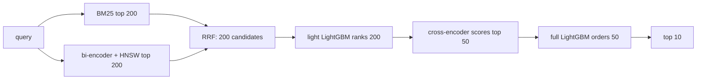

# Two-Stage Product Search Ranker

Product search on Amazon's [Shopping Queries dataset (ESCI)](https://github.com/amazon-science/esci-data).
Stage one retrieves candidates from a 482k product catalog.
Stage two reranks them with a cascade of LightGBM rankers and a fine-tuned cross-encoder.
A FastAPI service answers in 45 ms at p50 on an M4 Pro laptop.



Data is the US English slice of the task 1 "small" version: 29.8k queries and 601k labelled query-product pairs.
The official test split stays untouched.
Official train queries are split by query into train (50%), ce_train (40%) and valid (10%), so no query lands in two splits.
ce_train fine-tunes the cross-encoder and LightGBM trains on train, so the ranker never sees cross-encoder scores on the cross-encoder's own training data.

## Setup

```sh
uv sync
uv run python -m ranker.download
uv run python -m ranker.bm25 test        # BM25 baseline
uv run python -m ranker.dense test       # dense retrieval, exact vs HNSW
uv run python -m ranker.retrieve test    # hybrid retrieval
uv run python -m ranker.finetune         # fine-tune the cross-encoder on ce_train, ~5 min on Apple MPS
uv run python -m ranker.cross artifacts/ce-esci   # score every labelled pair with it
uv run python -m ranker.train            # train light and full LightGBM, early stop on valid
uv run python -m ranker.train test       # evaluate and print feature importance
uv run python -m ranker.pipeline test    # end-to-end NDCG over the whole catalog
uv run uvicorn ranker.api:app            # GET /search?q=...&k=10
uv run python -m ranker.bench            # latency, replaying test queries through the API
uv run python -m ranker.drift            # PSI drift check over logs/requests.jsonl
```

If Hugging Face downloads stall, set `HF_HUB_DISABLE_XET=1`.

## Retrieval

Recall@k counts labelled Exact products found in the top k of the full 482k catalog.

| Retrieval | Test Recall@100 | Test Recall@200 |
|---|---|---|
| BM25 | 0.578 | 0.652 |
| Dense, `all-MiniLM-L6-v2` + HNSW | 0.518 | 0.598 |
| Hybrid, reciprocal rank fusion | 0.628 | 0.697 |

Dense retrieval loses to BM25 alone, since product queries are full of model numbers, sizes and brands.
It still adds 5 points of recall in the hybrid, because the two find different products.

HNSW gives up 0.007 recall against exact search and is 12x faster: 0.27 vs 3.24 ms per query, including encoding.
Exact search is a NumPy matrix multiply rather than FAISS.
faiss-cpu and torch each bundle their own OpenMP runtime, and on macOS running both in one process aborts.

## Ranking

NDCG@10 uses the KDD Cup gains: Exact 1.0, Substitute 0.1, Complement 0.01, Irrelevant 0.
Here the ranker reorders each query's labelled products, the official task 1 setup.

| Model | Valid NDCG@10 | Test NDCG@10 |
|---|---|---|
| Random order | 0.573 | - |
| BM25 | 0.701 | 0.703 |
| LightGBM, 9 lexical features | 0.725 | 0.723 |
| + embedding cosine | 0.738 | 0.737 |
| + zero-shot cross-encoder score | 0.743 | - |
| same, LightGBM on half the train queries | 0.740 | - |
| Zero-shot cross-encoder alone, `ms-marco-MiniLM-L6-v2` | 0.718 | 0.719 |
| Fine-tuned cross-encoder alone | 0.753 | 0.750 |
| Light LightGBM: lexical + cosine | 0.735 | 0.734 |
| Full LightGBM: + fine-tuned cross-encoder | 0.764 | 0.759 |

Random order already scores 0.57 because most labels are Exact or Substitute.

Lexical features stop helping around 0.725.
These were tried and dropped, all within 0.001 of the baseline on valid:

- BM25 rank and score relative to the query's other candidates. These also change meaning when serving ranks retrieved candidates instead of labelled ones.
- A title-only BM25 score.
- Brand mismatch, for queries that name a brand the product doesn't have.

What's left is mostly telling Exact from Substitute when the words overlap, which needs a model of meaning.
The embedding cosine was the first feature to move the number.
The fine-tuned cross-encoder moved it most, and takes 68% of the full model's gain.

The cross-encoder is fine-tuned for one epoch on 8.3k ce_train queries, with the ESCI gain as a soft BCE target, in about 5 minutes on Apple MPS.
Holding those queries out costs LightGBM 0.003, and fine-tuning pays it back many times over.

## End to end

Each test query searches the whole catalog and the top 10 is scored.
Products nobody labelled count as gain 0, so these numbers are a lower bound and much lower than the reranking ones.

| System | Test NDCG@10 |
|---|---|
| BM25 top 10 | 0.317 |
| Hybrid RRF top 10 | 0.329 |
| Full pipeline | 0.372 |

## Serving

`ranker.bench` replays 500 test queries through the API one at a time, on an M4 Pro with the transformers on MPS.

| Stage | p50 ms | p95 ms |
|---|---|---|
| Encode query | 4.7 | 5.3 |
| Retrieve 200, BM25 + HNSW + RRF | 3.0 | 4.8 |
| Features for 200 | 14.7 | 18.2 |
| Light ranker | 0.6 | 0.7 |
| Cross-encoder on top 50 | 19.2 | 22.2 |
| Full ranker | 0.6 | 0.8 |
| Total including HTTP | 44.7 | 49.9 |

The cross-encoder takes 20 ms for 50 pairs and 70 ms for 200, which is why only the light ranker's top 50 reach it.
Requests run one at a time behind a lock, since the models share one GPU.

Every request is logged to `logs/requests.jsonl`.
`ranker.drift` compares the log with a reference using PSI, on query length (input) and the top result's score (output).
On replayed test queries both stay stable, at 0.001 and 0.059.
On 300 Spanish queries from the ESCI es slice, query length still looks stable at 0.093, but the top score flags drift at 1.086.
An input-only monitor would have missed it.
